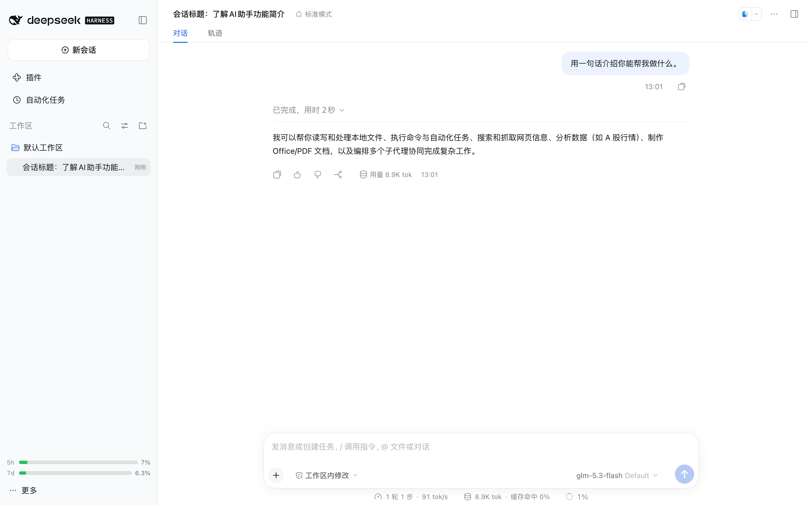
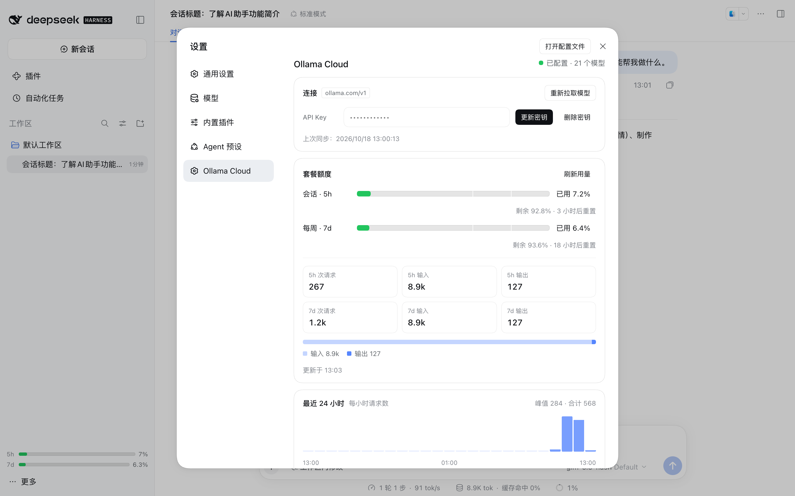
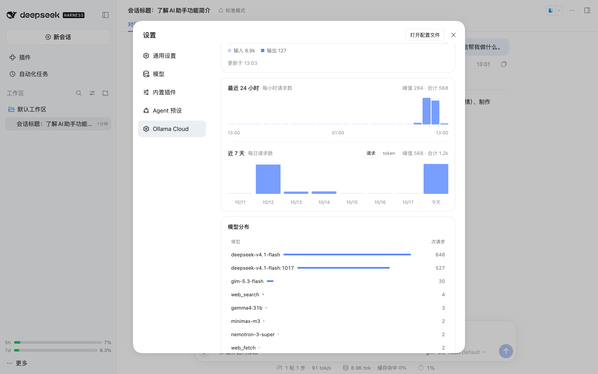

# dsh-ollama-cloud

Ollama Cloud for [DeepSeek Harness](https://github.com/deepseek-ai/deepseek-harness) (`dsh`). One API
key; no local Ollama install.

English | [中文](README.zh.md)



## Install

```sh
# desktop app profile and/or web profile
dsh plugin --profile desktop add git:github.com/pei-lin-001/dsh-ollama-cloud
dsh plugin --profile web add git:github.com/pei-lin-001/dsh-ollama-cloud
```

Open **Settings → Ollama Cloud**, paste a key from
[ollama.com/settings/keys](https://ollama.com/settings/keys), and press **保存并同步** (save and
sync). The key goes into the credentials service (`$DSH_HOME/.credentials.yaml`) and never reaches
the browser. The catalog is written to the `llm-pi-ai` settings section as route `ollama-cloud`, and
the models appear in the picker.

`OLLAMA_API_KEY` in the process environment also works. It shadows a stored key, and the credentials
service then refuses writes.

Development checkout:

```sh
git clone git@github.com:pei-lin-001/dsh-ollama-cloud.git ~/Dev/dsh-ollama-cloud
cd ~/Dev/dsh-ollama-cloud && dsh plugin --profile web add link:$PWD
./scripts/link-peers.sh   # schemastery, dsh-credentials, dsh-settings, dsh-tools
```

A linked package resolves peers from its own `node_modules`, which is why the last step exists.

## What it does

On boot, on credential change, and on demand, the plugin pulls the account's catalog and writes it as
an `llm-pi-ai` route: `GET /v1/models` for the ids, then one `POST /api/show` per model. Chat, tools,
vision and thinking are served by `dsh-llm-pi-ai` (`api: openai-completions`,
`baseURL: https://ollama.com/v1`); the plugin supplies the catalog and the credential, and
`dsh-llm-pi-ai` does the transport.

Model entries come from `/api/show`:

- `capabilities` decides which models get tools, vision and a thinking set. Models without `tools`
  are skipped unless `includeNonToolModels` is on.
- `<arch>.context_length` becomes `contextWindow`.
- `thinking.values` becomes `reasoningEfforts`. `false` maps to `off: 'none'`, since sending nothing
  would fall back to the model default (usually on). `true` maps to a single `medium` level. Graded
  names map one-to-one, so a model advertising both `xhigh` and `max` offers both.

The list replaces the route's models, and an unchanged section is not rewritten.

Two tools come with it: `ollama_web_search` and `ollama_web_fetch` call `/api/web_search` and
`/api/web_fetch` with the same key.

Quota and usage come from `GET /api/balance` (5h session, 7d weekly) and `GET /api/usage`. A current
plan reports tokens and cost there; a legacy plan reports requests only. For legacy plans the plugin
taps the `usage` chunk its own requests emit through `llm/stream`, counts input/cached/output per
model in hourly buckets, keeps 30 days in `$DSH_HOME/ollama-cloud-usage.json`, and aligns the totals
with the reset times the balance reports. Other clients' traffic stays invisible to that meter, so
server numbers win when they exist.

Every history image is re-sent on every step, and Ollama Cloud rejects an oversized request at the
gateway before the model runs (413, around 12 MB observed). The plugin keeps image base64 under 6 MiB:
on `0.2.x` it writes `maxRequestImageBytes` into the route, so the adapter stops at the bound and the
harness offloads the oldest images and retries with placeholders; on `0.1.0-rc.x`, whose adapter has
no such bound, the plugin drops the oldest images from the outgoing request itself. Text is not part
of that budget.

## UI





The settings page has five parts: connection, quota bars, charts, model context, per-model table. The 24h chart is
hourly requests. The 7d chart switches between requests and tokens, because requests are the series
every plan returns. The sidebar footer shows both quota windows. UI copy is Chinese.

## Configuration

Entry config is the `ollama-cloud` settings section; override it in the profile patch:

```yaml
- id: ollama-cloud
  config:
    provider: ollama-cloud        # llm-pi-ai route name
    displayName: Ollama Cloud
    apiKeyRef: OLLAMA_API_KEY     # credential reference, never the secret
    baseURL: https://ollama.com
    syncOnStart: true             # pull the catalog on boot
    includeNonToolModels: false   # keep tool-less models out of the picker
    webTools: true                # register ollama_web_search / ollama_web_fetch
    maxOutputChars: 20000         # per ollama_web_fetch result
    usageCacheSeconds: 120        # /api/balance + /api/usage cache
    maxRequestImageBytes: 6291456 # base64 image budget per request; 0 = adapter default
```

A model's `contextWindow` comes from `/api/show`. Override it on the settings page (模型上下文) or from
the composer's 上下文 chip beside the model button; the choice is kept in
`$DSH_HOME/ollama-cloud-context.json` and layered on top of every catalog sync. Resetting a model
restores the reported value.

## Command and routes

`/ollama-cloud [status|sync|usage]`, defaulting to `usage`:

```
Ollama Cloud 用量：
  会话（5h） ▕█░░░░░░░░░▏ 已用 7.2% · 3 小时后重置
  每周（7d） ▕█░░░░░░░░░▏ 已用 6.4% · 18 小时后重置
  5h 统计：267 次请求 · 输入 8.9k · 输出 127
  7d 统计：1.2k 次请求 · 输入 8.9k · 输出 127
```

The settings page and the sidebar use these routes over the same origin; scripts can too.

| Method | Path | Purpose |
|---|---|---|
| `GET` | `/_dsh/ollama-cloud/status` | key configured?, route, model count, last sync |
| `GET` | `/_dsh/ollama-cloud/usage[?force=1]` | balance windows, usage, token totals |
| `POST` | `/_dsh/ollama-cloud/key` | `{ "key": "…" }` stores and syncs, `{ "remove": true }` deletes |
| `POST` | `/_dsh/ollama-cloud/sync` | re-pull the catalog |

`/key` and `/sync` write. They take the app's own page only (same origin, or an opaque `file://`
origin) and a loopback or IP-literal `Host`; everything else gets 403.

## Runtime compatibility

| Runtime | Settings seam | Behavior |
|---|---|---|
| `0.1.0-rc.x` | `ctx.settings.register` / `get` | the plugin owns the `ollama-cloud` section; the adapter's section is read with `get('llm-pi-ai')` |
| `0.2.x` (desktop) | `describe` / `mutate` | the entry config is the section; the adapter's entry is read with `describe()` and written with `mutate()` |

`engines.dsh` accepts `>=0.1.0-rc.6 <1.0.0`, so both runtimes load the bundle. Tested on
`0.1.0-rc.6` (CLI) and `0.2.1-rc.2` (the desktop app's bundled runtime). CSS tokens carry literal
fallbacks, so the older runtime renders the same layout with plainer colors.

## Known limits

There is no way to cap output from here. pi-ai's compatibility probe sends `max_completion_tokens`,
which Ollama ignores (it honors `max_tokens`), and `dsh-llm-pi-ai` exposes no switch for that field.

The local meter only sees traffic from this harness home. Another machine or another client will not
appear in the token totals, and hourly buckets can put a window edge off by up to an hour.

When the catalog changes, the sync replaces `llm-pi-ai.providers.ollama-cloud` whole, so any hand
edits to that route are lost. `syncOnStart: false` makes syncing a manual step.

`webTools` and `includeNonToolModels` are read when the tools register, so changing them needs a
restart. Client-side changes also need one.

The usage endpoint allows 10 requests per minute per user. One refresh is three calls, which is why
the result is cached and the sidebar polls every five minutes.

## Development

```sh
node test/smoke.mjs   # catalog mapping, thinking levels, usage math, meter, route guards
```

No build step. The host half is plain ESM; the client half is written in the loader's factory form
(`window.__ModuleLoader__.load({ id, factory })`).

To run the web profile on the desktop app's bundled runtime:

```sh
APP="/Applications/DeepSeek Harness.app/Contents/MacOS/DeepSeek Harness"
CLI="$APP/../Resources/app.asar/dsh/node_modules/@deepseek-ai/dsh-desktop-host/lib/cli.js"
ELECTRON_RUN_AS_NODE=1 DSH_HOME=/tmp/probe "$APP" --expose-internals "$CLI" --profile web --port 8130 --no-open
```

License: MIT.
