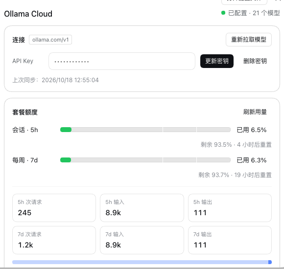
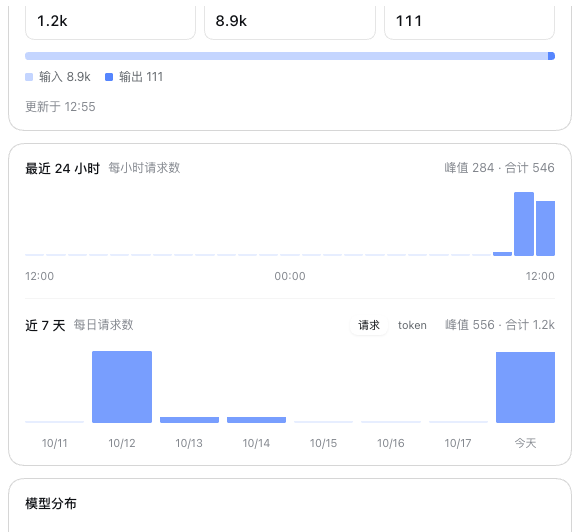
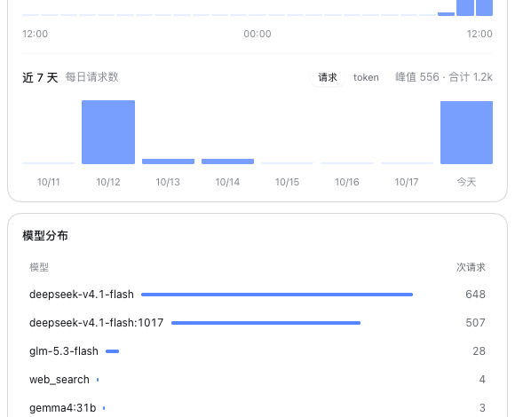

# dsh-ollama-cloud

Ollama Cloud provider for [DeepSeek Harness](https://github.com/deepseek-ai/deepseek-harness) (`dsh`).

One API key. No local Ollama server. The plugin pulls the live cloud catalog, registers it as an
`llm-pi-ai` provider route with each model's real thinking levels, adds the hosted web tools, and
shows plan quota plus token usage in the harness UI.



## What it gives you

| | |
|---|---|
| **One-key setup** | The key lives in the credentials service (`$DSH_HOME/.credentials.yaml`); the browser never sees it. Saving a key triggers the first catalog pull. |
| **Auto-pulled catalog** | `GET /v1/models` plus one `POST /api/show` per model, written into the `llm-pi-ai` settings namespace as route `ollama-cloud`. Runs on boot, on credential change, on demand. |
| **Real thinking levels** | Per-model `reasoningEfforts` derived from the model's own `/api/show` `thinking.values`, so only levels that model accepts are offered. |
| **Chat, tools, vision** | Served by `@deepseek-ai/dsh-llm-pi-ai` (`api: openai-completions`, `baseURL: https://ollama.com/v1`). This plugin owns data, not transport. |
| **Hosted web tools** | `ollama_web_search` and `ollama_web_fetch` call Ollama Cloud's `/api/web_search` and `/api/web_fetch` with the same key. |
| **Quota bars** | `GET /api/balance` gives the two windows the Ollama UI draws — 5h session and 7d weekly — each with a remaining percentage and reset time. |
| **Usage and tokens** | Requests, per-model breakdown, and tokens/cost from `/api/usage`; where the plan hides tokens, a local meter fills them in. |
| **Chinese UI** | Settings section, sidebar chip, command output. Tool descriptions stay English (they steer the model). |

## Install

```sh
# the desktop app's profile and/or the web profile
dsh plugin --profile desktop add git:github.com/pei-lin-001/dsh-ollama-cloud
dsh plugin --profile web add git:github.com/pei-lin-001/dsh-ollama-cloud
```

Then start the profile, open **Settings → Ollama Cloud**, paste the key from
[ollama.com/settings/keys](https://ollama.com/settings/keys) and press **保存并同步**. The catalog
lands in the profile patch under `llm-pi-ai.providers.ollama-cloud` and the models appear in the
model picker immediately.

`OLLAMA_API_KEY` in the environment also works (the credentials service layers it above the file).
A process-environment value shadows the stored one, and the credentials seam refuses writes while
it is shadowed.

**Development checkout** (`link:` instead of `git:`) — a linked package resolves its peers from its
own `node_modules`, so run the helper once:

```sh
git clone git@github.com:pei-lin-001/dsh-ollama-cloud.git ~/Dev/dsh-ollama-cloud
cd ~/Dev/dsh-ollama-cloud && dsh plugin --profile web add link:$PWD
./scripts/link-peers.sh          # symlinks schemastery, dsh-credentials, dsh-settings, dsh-tools
```

## The UI

The Settings section follows the harness settings pages (same card, type and spacing tokens) and
reads top to bottom as one story: **connection → quota → trend → per model**. No prose, only labels,
numbers, charts and tooltips.

### Quota

Two horizontal bars, one per window, with ticks at the 60% / 80% warn thresholds and coloring that
follows usage (green → amber → red). Each row carries used %, remaining % and the reset countdown.
Below them, six tiles put the numbers behind the bars: requests and input/output tokens for both
windows, plus a segmented bar of the 7d token split with a legend.

### Usage



Column charts drawn with flex boxes (crisp labels, container-width responsive), zero hours kept as a
baseline, and a peak/total caption in each header. The 24h chart is always per-hour requests; the 7d
chart toggles between **请求** and **token**, because requests are the series every plan reports.



The per-model table keeps its magnitude bars; token and cost columns appear only when the plan
discloses them, otherwise the table collapses to model + requests.

### Sidebar


The footer shows the same two windows as two labelled rows, each bar colored by its own usage. In the
collapsed rail the labels and numbers drop out and only the bars remain. Every row carries the full
used / remaining / reset detail in its tooltip.

## How it works

```
                 ┌────────────────────────────── dsh host ──────────────────────────────┐
 key ──────────► │ credentials.resolve(OLLAMA_API_KEY)                                  │
                 │        │                                                             │
                 │        ├─► GET /v1/models ─┐                                         │
                 │        │                   ├─► catalog ──► settings: llm-pi-ai        │
                 │        └─► POST /api/show ─┘   (route ollama-cloud)  ▲                │
                 │                                                     │ dsh-llm-pi-ai   │
                 │  llm/stream usage chunk ──► local token meter ───────┘ serves the     │
                 │  (/usage?range=…, /api/balance) ──► UI routes        route           │
                 └──────────────────────────────────────────────────────────────────────┘
```

**Catalog.** `/v1/models` lists ids; one `/api/show` per id yields `capabilities`
(`tools` / `thinking` / `vision`), `<arch>.context_length`, and `thinking.values`. Models without
`tools` are skipped unless `includeNonToolModels` is on. The result replaces the route's model list
whole, and an identical section is not rewritten (no churn for the adapter).

**Thinking levels.** `thinking.values` is what the model accepts: `false` becomes `off: 'none'`
(sending nothing would fall back to the model default, which is usually thinking *on*), `true`
becomes one `medium` level, and graded names map one-to-one — a model advertising both `xhigh` and
`max` offers both.

**Tokens.** `/api/usage` reports token counts and cost only on a current plan; a legacy plan returns
request counts alone. The plugin therefore taps the `usage` chunk every request already emits
(`llm/stream`), accumulates input/cached/output per model in hourly buckets, keeps 30 days in
`$DSH_HOME/ollama-cloud-usage.json` (debounced atomic write, `0600`), and anchors those totals to the
same windows the balance reports via each window's reset time. Usage from other clients (pi CLI,
curl, another machine) is invisible to that meter — which is why server numbers win whenever they
exist.

## Configuration

Entry config is the `ollama-cloud` settings section; override it in the profile patch:

```yaml
- id: ollama-cloud
  config:
    provider: ollama-cloud        # llm-pi-ai route name
    displayName: Ollama Cloud
    apiKeyRef: OLLAMA_API_KEY     # credential reference, never the secret
    baseURL: https://ollama.com
    syncOnStart: true             # pull the catalog on boot
    includeNonToolModels: false   # keep tool-less models out of the picker
    webTools: true                # register ollama_web_search / ollama_web_fetch
    maxOutputChars: 20000         # per ollama_web_fetch result
    usageCacheSeconds: 120        # /api/balance + /api/usage cache
```

## Surfaces

**Command** — `/ollama-cloud [status|sync|usage]` (default `usage`), plain text for any client:

```
Ollama Cloud 用量：
  会话（5h） ▕█░░░░░░░░░▏ 已用 6.5% · 4 小时后重置
  每周（7d） ▕█░░░░░░░░░▏ 已用 6.3% · 19 小时后重置
  5h 统计：245 次请求 · 输入 8.9k · 输出 111
  7d 统计：1.2k 次请求 · 输入 8.9k · 输出 111
```

**Web routes** (same-origin, used by the client half; scriptable):

| Method | Path | Purpose |
|---|---|---|
| `GET` | `/_dsh/ollama-cloud/status` | key configured?, route, model count, last sync |
| `GET` | `/_dsh/ollama-cloud/usage[?force=1]` | balance windows + usage + token totals (cached) |
| `POST` | `/_dsh/ollama-cloud/key` | `{ "key": "…" }` stores and syncs, `{ "remove": true }` deletes |
| `POST` | `/_dsh/ollama-cloud/sync` | re-pull the catalog |

Writes are accepted from the app's own page only (Electron serves it over `file://`, so an opaque or
file origin counts as the app itself) and refused for any other origin.

## API coverage

Everything an API key can reach on `ollama.com` that a coding harness can use:

| Endpoint | Used by |
|---|---|
| `POST /v1/chat/completions` | chat, tools, thinking, vision (via `dsh-llm-pi-ai`) |
| `GET /v1/models`, `POST /api/show` | catalog sync |
| `POST /api/web_search`, `POST /api/web_fetch` | the two tools |
| `GET /api/usage`, `GET /api/balance` | quota bars, usage charts, command |

Deliberately unused: native `/api/chat` / `/api/generate`, Anthropic `/v1/messages` and
`/v1/responses` (same capability, another wire the harness does not speak), `/api/tags` detail fields
(no display slot in a dsh model entry). Not reachable on cloud at all: `/api/ps`, `/api/embed`,
`/api/systemone`, `/api/version` (placeholder), and the local model-management endpoints
(`create`/`copy`/`pull`/`push`/`delete`) — those answer `401` for an API key.

## Runtime compatibility

One build serves both settings seams the harness has shipped:

| Runtime | Settings seam | Behavior |
|---|---|---|
| `0.1.0-rc.x` | namespace registration (`ctx.settings.register`/`get`) | the plugin owns the `ollama-cloud` section; the adapter section is read via `get('llm-pi-ai')` |
| `0.2.x` (desktop app) | profile-entry forms (`describe`/`mutate`) | the entry config *is* the section; the adapter's `llm-pi-ai` entry is read from `describe()` and written through `mutate()` |

`engines.dsh: ">=0.1.0-rc.6 <1.0.0"` replaces the peer-range check, so both runtimes load the bundle
instead of skipping it as incompatible. Verified against `0.1.0-rc.6` (CLI) and `0.2.1-rc.2` (the
desktop app's bundled runtime): catalog sync, chat, web tools, Settings section, sidebar chip. CSS
tokens carry literal fallbacks so the older runtime renders the same structure with plainer colors.

## Known limits

- **No hard output cap.** pi-ai's compatibility detection sends `max_completion_tokens`, which Ollama
  ignores (it honors `max_tokens`); `dsh-llm-pi-ai` exposes only `compat.thinkingFormat` and
  `compat.supportsReasoningEffort`, so the field cannot be corrected from here. `maxTokens` stays
  advisory.
- **Local metering is per harness home and per harness.** Another machine or client does not appear
  in the token totals, and hourly buckets mean a window edge can be off by up to an hour.
- **Sync owns the route.** Every sync rewrites `llm-pi-ai.providers.ollama-cloud` whole, so hand
  edits to that route are replaced. Set `syncOnStart: false` to sync by hand instead.
- `webTools` and `includeNonToolModels` are read when tools are registered; changing them needs a
  restart. The client bundle is served from a boot-graph hash, so UI changes also need a restart.
- The usage endpoint allows 10 requests/minute per user; one refresh is three calls, which is why
  answers are cached and the sidebar polls every five minutes.

## Development

```sh
node test/smoke.mjs      # catalog mapping, thinking levels, usage math, meter, write guard
```

No build step: the host half is plain ESM, the client half is written directly in the loader's
factory form (`window.__ModuleLoader__.load({ id, factory })`).

Testing against the desktop app's own runtime (its core is newer than the Homebrew CLI):

```sh
APP="/Applications/DeepSeek Harness.app/Contents/MacOS/DeepSeek Harness"
CLI="$APP/../Resources/app.asar/dsh/node_modules/@deepseek-ai/dsh-desktop-host/lib/cli.js"
ELECTRON_RUN_AS_NODE=1 DSH_HOME=/tmp/probe "$APP" --expose-internals "$CLI" --profile web --port 8130 --no-open
```

The `desktop` profile itself is bootable only by the Electron app, so it is exercised through the
composition it shares with `web` (`dsh-base` + `dsh-web-app`).

## License

MIT
